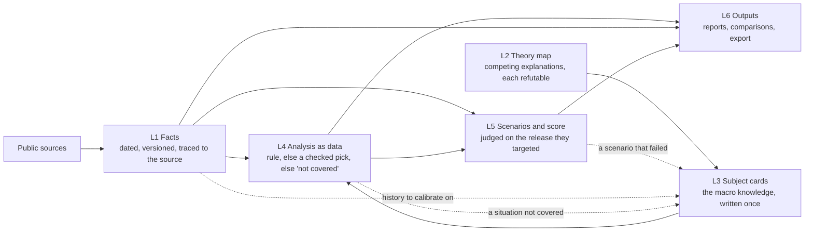

# Atlas Research

**Macro research as data: every number sourced, every call dated, every scenario scored.**

> The full design of Atlas, specified layer by layer before the build: what each layer receives, what
> it passes on, what it rejects, and the test that proves it works. The
> [build sequence](blueprint/build-sequence.md) gives the order. Nothing here is investment advice.

## The idea

Macro calls move money, yet the reasoning behind them is rarely audited afterwards: forecasts get
scored, the reading that produced them does not. A research report is a frozen document: it says that inflation is "above target and re-accelerating", leans on one or two
theories, sketches what could happen next, and is filed away. Six months later nobody can query it
alongside other reports, compare it line by line with the next one, or check it against the data as
they stood before revision.

Atlas is designed to turn the judgement part of that analysis, the analyst's reading of the
economy, into data. Every number points to the exact place in the source it was read from and to
the moment it became known. Every reading, every theory applied and every scenario is stored as a
dated choice, not as prose. A language model is used only as a selector: it returns one of a few
pre-written options, code checks the pick against the numbers, and it can never invent a figure or
a sentence. A report can then be:

- **queried:** every report that judged Fed policy tight while underlying inflation was falling;
- **compared:** what changed since last month's report, and whether the facts moved or only the
  reading did;
- **checked against revised data:** whether a reading still holds once its data are revised;
- **scored:** an analyst's call and the rules' call sit side by side, both dated, both judged on the
  release they targeted.

That is also the record a backtest needs: facts as they were knowable on each day, and calls recorded
forward from the day they were made, with no hindsight leaking in.

**For an investor**, it is the macro half of a decision log: which reading of the SNB, the franc and
rates stood when a position was opened or a deal underwritten, what would have changed it, and
whether it held.

A *card* is the audited knowledge file for one subject. **One stored report, as Atlas would have
recorded it** (illustrative rows on real 2024 releases; Atlas keeps no record from before it runs):

| As of | What was recorded | Value | Source | Decided by |
|---|---|---|---|---|
| 12 Jun 2024 | Core CPI inflation, year-on-year | 3.4% | BLS, May data, released 12 Jun | Rule (computed) |
| 12 Jun 2024 | Core PCE inflation more than 0.5 pt above the Fed's 2% target | yes (2.8%) | BEA, April data, released 31 May | Rule |
| 12 Jun 2024 | Lean of the FOMC statement | toward holding rates | FOMC statement, 12 Jun, passage quoted | Model pick from a fixed menu, code-checked |
| 12 Jun 2024 | Scenario, branch 1 of 2: core PCE's 3-month annualised pace is more than 0.5 pt above its 12-month rate (trigger met on 12 Jun), so October's core PCE inflation, at its published one-decimal figure, will be above April's 2.8% as first released; invalidated if unemployment rises 0.5 pt first | probability 60% | Card *US · inflation*, registered 12 Jun | Card, fixed in advance |
| 12 Jun 2024 | Branch 2 of 2: October's core PCE inflation at or below 2.8% | probability 40% | Same card | Card, fixed in advance |
| 27 Nov 2024 | Verdict: October core PCE inflation 2.8%, not above; unemployment rose less than 0.5 pt | branch 1 wrong, branch 2 right | BEA, October data, released 27 Nov | Judged on the first release |

Each row says what was known, from where, on which date, and what decided it. The call was wrong,
and the record says so: the miss is scored against a benchmark and goes back to the card.

## The method, already applied

I publish short studies in economics at [First Thing](https://first-thing-research.com) under the
same discipline: every printed number traced to its script or its source and date, every analysis
protocol committed before its result, with any exception stated on the protocol itself. Read a study
on the site, then its proof: protocols, code and data manifests are in [`first-thing/`](first-thing/),
where each number can be checked against its source and the script that computed it (the code is
published to be read; it relies on a private toolkit to run).

## The design

| Page | What it holds |
|---|---|
| [L1 · Facts](blueprint/L1-facts.md) | Public statistics, each value traced to its place in the source, each revised version (a *vintage*) kept, and the data readable exactly as they stood on any past date. |
| [L2 · Theory map](blueprint/L2-theory-map.md) | Competing economic explanations, called *lenses*, each stating what it assumes, where it fails and what would prove it wrong. The inflation and rates families come first, with four lenses worked in full; the long-run map, 72 lenses in 23 families, shows where it is thin. |
| [L3 · Subject cards](blueprint/L3-subject-cards.md) | The knowledge for one economy and subject, written once and audited: the situations to recognise, the lenses that read them, pre-written sentences, scenarios. |
| [L4 · Analysis as data](blueprint/L4-analysis.md) | Code decides what it can; otherwise a language model or an analyst picks one of a few pre-written options, and code checks the pick; the rest is declared "not covered". |
| [L5 · Scenarios and score](blueprint/L5-scenarios-score.md) | Conditional scenarios fixed in advance, judged against a benchmark when the release they targeted comes out. |
| [L6 · Outputs](blueprint/L6-outputs.md) | Reports assembled word for word from stored choices, report-to-report comparison, re-reading against revised data, a point-in-time export. |

Also: [overview](blueprint/README.md) (one report from source to score) ·
[principles](blueprint/principles.md) (the ten rules) · [data contracts](blueprint/data-contracts.md)
(records and time) · [build sequence](blueprint/build-sequence.md) (the order of construction) ·
[glossary](blueprint/glossary.md) (every term).

The build starts with US inflation, then extends to Switzerland (the SNB, the franc) and the euro
area by adding sources and cards, not by changing the engine.

## The rules that carry the idea

- **Rule 1 · Exact or absent.** A value traces back to its source document, or it is refused; a missing value is recorded with its reason, never as a zero.
- **Rule 2 · What was known, when.** Every query names a date and cannot see past it; a revision adds a vintage and erases nothing.
- **Rule 4 · Rule, then pick, then abstain.** Code decides first; a language model or an analyst only picks from a short list of pre-written options; otherwise the engine says "not covered".
- **Rule 8 · Analysis counts from the day it was made.** Facts can be replayed over the history archives keep; analysis is scored only from the day it was produced.

The other six, with why each matters and where it shows, are in the [design principles](blueprint/principles.md).

## Author

[Sami Andaloussi](https://github.com/Sami-Andaloussi), second-year economics student at HEC Lausanne.
Corrections are welcome, especially a missing lens in the theory map.
