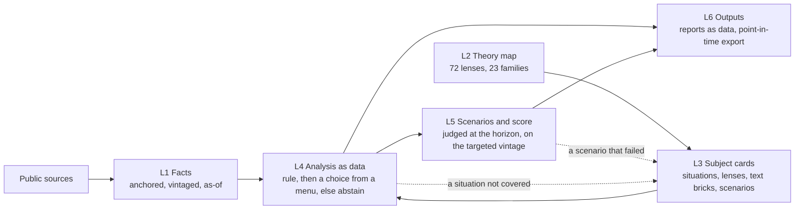

# Atlas Research

**Turning discretionary macro analysis into data.**

> **A blueprint.** Atlas is designed in full here, layer by layer, with what each layer takes in,
> what it hands on, what it refuses, and the order in which it would be built. Nothing here is
> investment advice.

## The idea

A macro research report is a frozen document. It states that inflation is "above target and
re-accelerating", leans on one or two theories, sketches what could happen next, and is then
filed away. Six months later nobody can query it, compare it with the report that followed it,
or check it against the data as they stood when it was written, before the statistical
offices revised them.

Atlas turns each report into data. Every number in it points to the bytes of the document it was
read from and to the date it became known. Every reading of the situation, every theory applied
and every scenario is stored as a dated, structured choice, not as prose. A report then becomes
something that can be:

- **queried:** every report that read the Fed as restrictive while core inflation was falling;
- **compared:** what changed between this month's report and last month's, and whether the facts
  moved or only the reading did;
- **confronted with revisions:** whether the report's reading still holds once the data it relied
  on have been revised, and whether its scenarios came true against the vintage they targeted.

## The layers

| Layer | What it holds |
|---|---|
| [L1 · Facts](blueprint/L1-facts.md) | Public series captured as bytes, each value anchored to its slice of the document, every revision kept as a new vintage, and a read "as of" any date that cannot see past it. |
| [L2 · Theory map](blueprint/L2-theory-map.md) | 72 competing explanations in 23 families, each stating its assumptions, inputs, a case where it fails, the baseline it must beat and what would count against it. |
| [L3 · Subject cards](blueprint/L3-subject-cards.md) | The macro knowledge, written once per economy and subject: the situations code can recognise, the lenses that apply, pre-written text, scenario templates. |
| [L4 · Analysis as data](blueprint/L4-analysis.md) | For a subject and a date, the facts are frozen, code rules on what it can, a language model picks from a short menu where it cannot, and the rest is declared "not covered". |
| [L5 · Scenarios and score](blueprint/L5-scenarios-score.md) | Scenarios with a trigger, an invalidation and an outcome fixed in advance, judged when their horizon passes; failures go back to the cards. |
| [L6 · Outputs](blueprint/L6-outputs.md) | Reports assembled word for word from stored choices, report-to-report comparison, re-reading against revisions, and a point-in-time export for quantitative research. |

## In two minutes

1. **Facts are exact or absent.** A value either traces back to the bytes it came from, or it is
   refused. A missing value is recorded as one of eleven kinds of absence, never as a zero.
2. **No free text.** Whatever can be scored is a structured choice: a named series, a threshold,
   a date, a card identifier. Whatever explains is pre-written text attached to those choices.
3. **Decisions go in a fixed order:** a code rule where one exists; otherwise a language model
   picks from a short menu of pre-written options that code has already filtered, and code
   checks the pick; otherwise the engine says "not covered", and the gap goes to the workshop
   that writes the cards.
4. **Knowledge lives in cards, not in code.** Adding a theory, a threshold or an economy means
   editing a card, not reprogramming the engine.
5. **Several explanations stand side by side.** Atlas keeps no house view. It records which
   lenses read the situation and what each would expect.
6. **Scenarios can be wrong, and are scored.** Each has at least two branches, an observable
   trigger, an invalidation condition and an outcome definition registered before its date.
7. **Coverage is measured.** Every run reports the share of decisions taken by rules, by menu
   choices, and the share left uncovered: the direct measure of how far discretionary analysis
   has become data.

The [blueprint overview](blueprint/README.md) follows one report from the source to its score.

## Reading it layer by layer

| Page | What it answers |
|---|---|
| [Blueprint overview](blueprint/README.md) | The whole system in one drawing, and the path of one report. |
| [Design principles](blueprint/principles.md) | The rules every layer follows. |
| Layer pages, [L1](blueprint/L1-facts.md) to [L6](blueprint/L6-outputs.md) | Purpose, interfaces, gates, steps, deliverables, refusals and a worked example on US inflation. |
| [Build sequence](blueprint/build-sequence.md) | The order of construction, phase by phase, and the gate that closes each phase. |
| [Glossary](blueprint/glossary.md) | Every term in plain words. |

## First Thing

[First Thing](https://first-thing-research.com) inherits Atlas's discipline: every number pinned
to a source and a date, what was knowable fixed before any result, and a check by someone
other than the producer. It applies that discipline with its own tools, not with Atlas's code.
The proof behind its published economic studies, with their protocols, code and data
manifests, is kept in [`first-thing/`](first-thing/).

## Author

[Sami-Andaloussi](https://github.com/Sami-Andaloussi). Corrections are welcome, especially "your
theory map is missing something".
