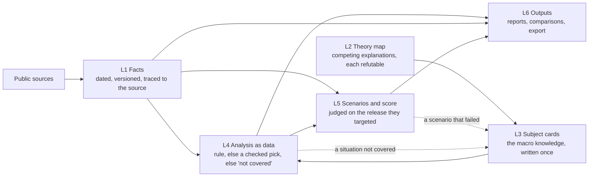

# Atlas Research

**Macro research as data: every number sourced, every call dated, every scenario scored.**

> The full design of Atlas, specified layer by layer before the build. Each layer states what it
> takes in, what it hands on, what it refuses and the test that proves it works; the
> [build sequence](blueprint/build-sequence.md) gives the order. Nothing here is investment advice.

## The idea

A macro research report is a frozen document. It says that inflation is "above target and
re-accelerating", leans on one or two theories, sketches what could happen next, and is filed away.
Six months later nobody can query it, compare it with the report that followed, or check it against
the data as they stood when it was written, before the statistical offices revised them.

Atlas is designed to turn that discretionary analysis, the analyst's reading of the economy, into
data. Every number points to the exact place in the source it was read from and to the moment it
became known. Every reading, every theory applied and every scenario is stored as a dated choice,
not as prose. A report can then be:

- **queried:** every report that read the Fed as restrictive while core inflation was falling;
- **compared:** what changed since last month's report, and whether the facts moved or only the
  reading did;
- **checked against revised data:** whether a reading still holds once its data are revised;
- **scored:** an analyst's call and the rules' call sit side by side, both dated, both judged on the
  release they targeted.

That is also the record a backtest needs: what was knowable on each day, with no hindsight leaking
in. For an investor, it is the macro half of a position log: which reading of rates, inflation and
the cycle was on the table when a position was opened, what would have changed it, and whether it
held.

**One stored report, illustrated:**

| As of | What was recorded | Value | Source | Decided by |
|---|---|---|---|---|
| 12 Jun 2024 | Core CPI, year-on-year | 3.4% | BLS, May data, released 12 Jun | Computed |
| 12 Jun 2024 | Core PCE more than 0.5 pt above the 2% target | true | BEA, April data, released 31 May | Rule |
| 12 Jun 2024 | Fed policy stance, against Taylor-type rules | restrictive | Fed funds target range, 12 Jun | Rule |
| 12 Jun 2024 | Lean of the FOMC statement | toward holding | FOMC statement, 12 Jun, passage quoted | Menu pick, checked |
| 12 Jun 2024 | If core PCE's 3-month pace beats its trend by 0.5 pt: core PCE higher six months on | p = 0.6 | Judged on October data, released late Nov | Card scenario |

Each row says what was known, from where, on which date, and what decided it: a rule in code, a
pick among pre-written options that code then checks, or a scenario written in advance in the
subject's *card*, the audited knowledge file for one topic.

## Already in use

The discipline is already applied in [First Thing](https://first-thing-research.com)'s published
studies in economics: every printed number traced to its script or its source and date, every
analysis protocol fixed before its result. The proof is in [`first-thing/`](first-thing/); start
with [FT-001, part 1](first-thing/FT-001-part-1-what-gives-a-money-its-value/). The studies follow
Atlas's method with their own tools.

## The design

| Page | What it holds |
|---|---|
| [L1 · Facts](blueprint/L1-facts.md) | Public statistics, each value traced to its place in the source, each revised version (a *vintage*) kept, and the data readable exactly as they stood on any past date. |
| [L2 · Theory map](blueprint/L2-theory-map.md) | 72 named economic explanations, called *lenses*, in 23 families, each stating what it assumes, where it fails and what would prove it wrong. Four are worked in detail. |
| [L3 · Subject cards](blueprint/L3-subject-cards.md) | The knowledge for one economy and subject, written once and audited: the situations to recognise, the lenses that read them, pre-written sentences, scenarios. |
| [L4 · Analysis as data](blueprint/L4-analysis.md) | Code decides what it can; otherwise a language model or an analyst picks one of a few pre-written options, and code checks the pick; the rest is declared "not covered". |
| [L5 · Scenarios and score](blueprint/L5-scenarios-score.md) | Conditional scenarios fixed in advance, judged against a benchmark when the release they targeted comes out. |
| [L6 · Outputs](blueprint/L6-outputs.md) | Reports assembled word for word from stored choices, report-to-report comparison, re-reading against revised data, a point-in-time export. |
| [Overview](blueprint/README.md) · [Principles](blueprint/principles.md) · [Data contracts](blueprint/data-contracts.md) · [Build sequence](blueprint/build-sequence.md) · [Glossary](blueprint/glossary.md) | One report from source to score; the ten rules; records and time; the order of construction; every term. |

The build starts with US inflation, then extends to Switzerland (the SNB, the franc) and the euro
area by adding sources and cards, not by changing the engine.

## The ten rules

1. **Exact or absent.** A value traces back to its source, or it is refused; a missing value is
   recorded with the reason it is missing, never as a zero.
2. **What was known, when.** Every read names a moment and cannot see past it; a revision adds a
   vintage and erases nothing.
3. **No free text.** What can be scored is a structured choice; what explains is a pre-written
   sentence attached to it.
4. **Rule, then pick, then abstain.** Code decides first; a model or an analyst only picks from a
   filtered list; otherwise the engine says "not covered".
5. **Knowledge in cards, not in code.** Adding a theory or an economy is writing a card, not
   reprogramming the engine.
6. **No house view.** Competing explanations are kept side by side; their disagreement is data.
7. **Falsifiable before its date.** A scenario has a trigger, an invalidation and an outcome fixed in
   advance, or it is refused.
8. **Analysis counts from the day it was made.** Facts can be replayed over history; analysis is
   scored only from the day it was produced.
9. **The producer is never the judge.** Nothing is accepted on the word of whoever produced it.
10. **Coverage is measured.** Coverage says how much of the analysis was fixed in advance; the score
    says whether it was right.

## Author

Sami Andaloussi, economics student at HEC Lausanne. Corrections are welcome, especially "your
theory map is missing a lens".
