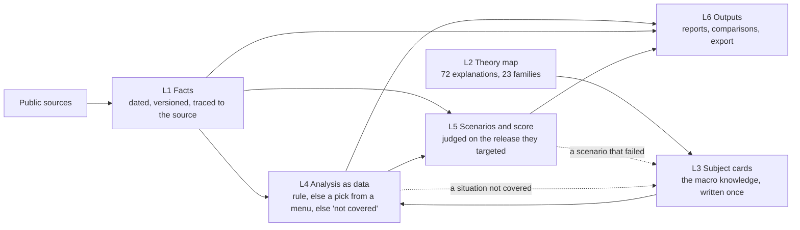

# Atlas Research

**Turning discretionary macro analysis into data.**

*Macro research that can be queried, compared and scored against what was actually known at the time.*

> **A blueprint, designed in full and to be built.** Each layer below states what it takes in, what
> it hands on, what it refuses, and the gate it must pass; the [build sequence](blueprint/build-sequence.md)
> gives the order of construction. Nothing here is investment advice.

## The idea

A macro research report is a frozen document. It says that inflation is "above target and
re-accelerating", leans on one or two theories, sketches what could happen next, and is then filed
away. Six months later nobody can query it, compare it with the report that followed, or check it
against the data as they stood when it was written, before the statistical offices revised them.

Atlas is designed to write its reports as data. Every number points to the exact place in the source
document it was read from, and to the moment it became known. Every reading of the situation, every
theory applied and every scenario is stored as a dated, structured choice, not as prose. A report
then becomes something that can be:

- **queried:** every report that read the Fed as restrictive while core inflation was falling;
- **compared:** what changed between this month's report and last month's, and whether the facts
  moved or only the reading did;
- **confronted with revisions:** whether a reading still holds once the data it relied on have been
  revised, and whether its scenarios came true on the release they targeted.

The same discipline is what a backtest needs: a record of what was knowable on each day, with no
hindsight leaking in.

## The layers

| Layer | What it holds |
|---|---|
| [L1 · Facts](blueprint/L1-facts.md) | Public statistics, each value traced to its place in the source document, every revision kept as a new version, and a read "as of" any past moment that cannot see beyond it. |
| [L2 · Theory map](blueprint/L2-theory-map.md) | 72 economic explanations in 23 families, most of them competing, each stating what it assumes, a case where it fails, the simpler reading it must beat and what would prove it wrong. |
| [L3 · Subject cards](blueprint/L3-subject-cards.md) | The macro knowledge for one economy and subject (US inflation, say), written once and audited: the situations to recognise, the theories that read them, pre-written sentences, scenario templates. |
| [L4 · Analysis as data](blueprint/L4-analysis.md) | For a subject and a date: code decides what it can; where it cannot, a language model picks one of a few pre-written options, and code checks the pick; the rest is declared "not covered". |
| [L5 · Scenarios and score](blueprint/L5-scenarios-score.md) | Conditional scenarios with a trigger, an invalidation and an outcome fixed in advance, judged against a benchmark when the release they targeted comes out. |
| [L6 · Outputs](blueprint/L6-outputs.md) | Reports assembled word for word from stored choices, report-to-report comparison, re-reading against revised data, and a point-in-time export for quantitative research. |

## In two minutes

1. **Facts are exact or absent.** A value either traces back to its source document, or it is
   refused. A missing value is recorded with the kind of absence it is, never as a zero.
2. **No free text.** Whatever can be scored is a structured choice: a named series, a threshold, a
   date, an entry of a card. Whatever explains is a pre-written sentence attached to those choices.
3. **Decisions go in a fixed order:** a code rule where one exists; otherwise a language model picks
   from a short list of pre-written options that code has already filtered, and code checks the
   pick; otherwise the engine says "not covered", and the gap goes to the workshop that writes the
   cards.
4. **Knowledge lives in cards, not in code.** Adding a theory, a threshold or an economy means
   writing and auditing a card, not reprogramming the engine.
5. **Several explanations stand side by side.** Atlas holds no single explanatory view. It records
   which theories read the situation and what each would expect.
6. **Scenarios can be wrong, and are scored.** Each branch has an observable trigger, an invalidation
   and an outcome definition registered before its date, and is credited only if it beats a
   benchmark.
7. **Coverage is measured.** Every run reports the share of decisions taken by rules, by menu
   choices, and what was left uncovered, including situations no card anticipated: the direct
   measure of how far discretionary analysis has become data.

The [blueprint overview](blueprint/README.md) follows one report from the source to its score.

## Reading it layer by layer

| Page | What it answers |
|---|---|
| [Blueprint overview](blueprint/README.md) | The whole system in one drawing, and the path of one report. |
| [Design principles](blueprint/principles.md) | The ten rules every layer follows. |
| Layer pages, [L1](blueprint/L1-facts.md) to [L6](blueprint/L6-outputs.md) | Purpose, interfaces, gates, steps, deliverables and refusals of each layer. |
| [Data contracts](blueprint/data-contracts.md) | Identifiers, records, time, the single read, idempotency, replay, a reference stack. |
| [Build sequence](blueprint/build-sequence.md) | The order of construction, phase by phase, and the gate that closes each phase. |
| [Glossary](blueprint/glossary.md) | Every term in plain words. |

## First Thing

[First Thing](https://first-thing-research.com) publishes sourced studies in economics. It inherits
Atlas's discipline (every number pinned to its source and its date, every protocol fixed before its
result, every claim typed by the evidence behind it) and applies it with its own tools,
not with Atlas's code. The proof behind its published studies, with their protocols, code and data
manifests, is in [`first-thing/`](first-thing/).

## Author

[Sami-Andaloussi](https://github.com/Sami-Andaloussi). Corrections are welcome, especially "your
theory map is missing something".
