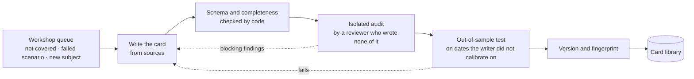

[← L2](L2-theory-map.md) · [Up: Blueprint](README.md) · [L4 →](L4-analysis.md)

# L3 — Subject cards and the workshop

## TL;DR

The macro knowledge of Atlas, written once per economy and subject, in a card the engine can evaluate but never edit.
A card holds the situations code can recognise, the lenses that read them, pre-written text, scenario templates and the menus left to a model.
The workshop writes each card from sources, has it audited by someone who did not write it, tests it out of sample, and reopens it when production finds a gap or a scenario fails.

## Purpose

Put the discretionary part of macro analysis (what counts as "above target", which theory reads
it, what could happen next, how to say it) **into versioned files that can be read, audited and
corrected**, so that the engine itself stays generic.

**Success looks like:**
- Every non-trivial threshold in a card is justified in one line, with its source, its calibration
  or the admission "conventional, unsourced".
- A card passes its schema, its audit and a historical out-of-sample test before any report uses
  it, and its scenarios are scored only from its acceptance date, live.
- Adding a subject, a lens or an economy is writing a card, never a change to the engine.

## What a card contains

A card is keyed by economy and subject (for instance *US · inflation*) and carries a version and a
fingerprint.

| Part | What it is | Example (US inflation) |
|---|---|---|
| Series | The catalogue keys the card reads, including dated facts such as the target in force | CPI and PCE, headline and core; long-run expectations; unemployment gap; the inflation target |
| Quantities | Values computed from series with a closed set of operations (below), each with the latest period it may be from | core PCE year-on-year; core PCE three-month pace; gap of PCE to the target in force |
| Situations | Code conditions on quantities, combined with *all of* / *one of*, each with its claim kind | "PCE or core PCE more than half a point above the target" |
| Calibrated ranges | For each quantity, the range seen in its calibration period | Core PCE three-month pace between its 1st and 99th percentiles |
| Lenses | Lenses of the theory map, pinned by version, that read the subject, each with the quantities it reads, why, and the baseline it is compared with | New Keynesian sticky prices reads core pace, core trend, the unemployment gap, the gap to target and long-run expectations |
| Text bricks | Pre-written sentences for each situation or lens reading, with holes for numbers and two or three variants | "Total ({pce} %) or core ({pce_core} %): PCE inflation exceeds 2 % by more than half a point on at least one measure." |
| Scenario templates | Sets of conditional branches: if a trigger fires, an outcome follows by the horizon, unless an invalidation comes first; each with its lens and the observable that would show that lens's mechanism at work | If core pace runs half a point above its trend, core inflation is higher at six months (cost-push branch: wage growth also above trend) |
| Menus | The judgements left to a model: options, each with the conditions under which it is offered and those that must confirm it afterwards | How a central-bank statement leans, classified against a fixed codebook; the tone of the reading |
| Analogue specification | Where the card allows historical analogues: the state vector, its scaling, the distance and the exclusion window | Core pace, unemployment gap and expectations, standardised, ±12 months excluded |

**The closed operations**, the only computations a card can ask for: year-on-year change,
annualised pace over *n* periods, difference, ratio, log-difference, absolute value, average,
rolling quantile, resampling to a lower frequency with a declared method, gap between two series
(an as-of join on period end), linear combination, and weighted contribution with vintaged weights.
Anything a model estimates (an output gap, a neutral rate, a term premium) enters as a published
series.

A card the size of US inflation runs to some twenty series, about fifty quantities, forty
situations and seventy text bricks. That is the scale at which a subject is covered without
improvisation.

## Rules every card follows

- **A justified threshold.** Each non-trivial threshold has one line: its source (the FOMC's 2 %
  target on headline PCE, stated in January 2012), or a calibration ("10th and 90th percentiles of
  the series over 2010–2019"), or the admission "conventional, unsourced".
- **True at every date.** Each brick carries the interval of dates in which it may be printed, and
  the renderer checks it. "2 %, the FOMC's explicit target since January 2012" may only be printed
  from that month on.
- **A rounded number never contradicts its word.** A situation that a text will state is evaluated
  on the value as it will be displayed, so "more than half a point above" never sits next to a
  printed gap of 0.5. Two numbers printed side by side are described by their order, never by a gap
  computed from unrounded values.
- **Variants without drift.** The two or three variants of a brick say the same thing; code picks
  one from the row's identifier, so the same data always give the same page.
- **A causal claim cites its evidence.** A situation or brick typed as causal names its mechanism,
  its rivals and the study that identified the effect; the engine does not infer causality, it
  cites it.
- **A lens says why.** Each lens on a card states, in a sentence with its reference, why it reads
  this subject and which quantities it reads.
- **Invalidation excludes the trigger.** No scenario branch can be triggered and invalidated by the
  same observation.

## Composing subjects

Some readings span subjects: a "regime" card reads situations from the inflation, jobs and rates
cards together. It does so by pinning each card it reads by fingerprint, so a change to the
inflation card cannot silently change what the regime card means. Composed cards are audited like
any other, out of sample included.

## The workshop

1. **The queue.** Work enters the workshop from three places: a new subject in the build sequence,
   a "not covered" abstention from production ([L4](L4-analysis.md)), and a scenario judged wrong
   ([L5](L5-scenarios-score.md)).
2. **Writing.** The card is written from the library of reference works. A macro question is never
   settled from memory: it is looked up, and the answer is cited.
3. **Code checks.** The schema, the completeness (every situation has a brick, every scenario branch
   has a trigger, an invalidation and an outcome), and that every lens cited exists on the map.
4. **Isolated audit.** A reviewer who wrote none of the card checks it against its sources and
   against the principles: the thresholds, the truth of each brick at every date, the economics of
   each lens reading.
5. **Out-of-sample test.** The card's rules and scenarios are run on a test period declared before
   calibration (for a first card: calibrated on 2000–2014, tested on 2015–2019 and 2022–2025). A
   writer who chose a trigger after looking at both samples says so, and the card waits for a clean
   test. Because writer and reviewer both know how history turned out, a historical test can only
   reject a card; the test that counts is the live record that starts at acceptance
   ([principle 8](principles.md#8-analysis-is-clean-from-its-production-date)).
6. **Versioning.** The accepted card is fingerprinted. Reports pin the version they used.

## Interfaces

| Direction | Artefact | From / to |
|---|---|---|
| in | Theory catalogue | [L2](L2-theory-map.md) |
| in | Series catalogue and captured history, for calibration | [L1](L1-facts.md) |
| in | "Not covered" abstentions | [L4](L4-analysis.md) |
| in | Failed scenarios | [L5](L5-scenarios-score.md) |
| out | Card library, versioned and fingerprinted | [L4](L4-analysis.md), [L6](L6-outputs.md) |
| out | Audit records | Kept with each card version |
| out | New series wanted | [L1](L1-facts.md) catalogue |
| out | New lenses wanted | [L2](L2-theory-map.md) |

## Gates

**Entry.** The card format is fixed and checked by a schema; the series the card needs are in the
fact store.

**Exit.** A card is accepted when:
- its schema and completeness checks pass;
- its audit has no blocking finding left unanswered;
- its historical out-of-sample test passes on the declared test period;
- every non-trivial threshold has its line of justification.

The layer is complete for a phase when every subject of the phase has an accepted card, and a real
abstention from production has gone through the queue and come back as a card used in a later
report.

## Steps

1. **Format.** *Design.* The card schema, its closed operations and its condition language.
2. **First card.** *Design.* US inflation, the subject the build starts with.
3. **Audit protocol.** *Design.* What the reviewer checks, what counts as blocking.
4. **Out-of-sample protocol.** *Design.* How calibration and test periods are split and declared.
5. **Queue.** *Execution.* Abstentions and failed scenarios enter it with their context.
6. **Composition.** *Design and execution.* Cards that read other cards, pinned by fingerprint.

## Deliverables

- The card schema and its checker.
- One accepted card per subject and economy of the phase.
- The audit record and out-of-sample result of each version.
- The workshop queue, with what entered it and what came out.

## What it refuses

| It refuses | Because |
|---|---|
| A threshold with no justification line | An unjustified number is an opinion in disguise. |
| A brick that is false at some date it could be printed | The page would be wrong without anyone noticing. |
| A card audited by its writer | The producer is never the judge. |
| A scenario calibrated on the period it is tested on | That is fitting, not testing. |
| Knowledge written into the engine's code | It would be invisible to the audit and change every subject at once. |
