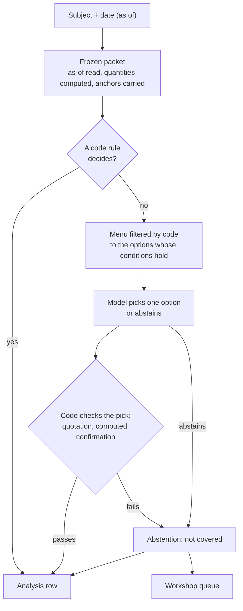

[← L3](L3-subject-cards.md) · [Up: Blueprint](README.md) · [L5 →](L5-scenarios-score.md)

# L4 — Analysis as data

## TL;DR

For a subject and a date, the engine freezes what was known, computes what the card asks for, and decides in a fixed order: a code rule, else a model's pick from a filtered menu, else "not covered".
Every decision becomes a dated, typed row with its run log, so an analysis can be queried, compared and scored like a price index.
No sentence is ever written by the model: it chooses identifiers, and code checks every choice.

## Purpose

Turn the reading of a situation, the most discretionary step in macro research, into **rows in a
table**: which situations hold, which lenses read them, which scenarios open, in which tone, as of
which date, on which data and which card versions.

**Success looks like:**
- Every row can be reproduced from its run log: same data, same card versions, same rows.
- No row contains free text; every explanation is a reference to a pre-written brick.
- Every run publishes its coverage: share of decisions by rule, by menu choice, and abstained.

## The run

### 1. The frozen packet

For a subject and a date, code reads the fact store **only through the as-of read** and computes
every quantity the card declares, in the card's order, with the closed operations.

- Each quantity is a series (period to value), so averages and gaps can read its history; its value
  in the packet is the last computable period.
- Each value carries the anchors of the values it was computed from: document, fingerprint, offset,
  date known.
- What cannot be computed is `None` with its reason: a month never published, a hole in the
  periods, a pace asked of a daily series.
- **A period that starts after the date is a projection, and is discarded.** Budget offices publish
  potential output and natural unemployment ten years ahead; without this rule, a packet would read
  2034 as the present.
- A gap between two series is an as-of join: for each period of one, the latest value of the other
  at or before it.

### 2. Rules

Code evaluates the card's situations on the packet. No model is involved.

### 3. Menu choices

Where the card leaves a judgement to a menu (the tone of a reading, which of several mechanisms is
driving), code first filters the menu to the options whose conditions hold. If one option is left,
it is taken without a model. If several are left, a language model picks one and returns an
identifier, plus a verbatim quotation where the card asks for one. It may also abstain. The prompt
is versioned.

### 4. Checks

Code checks every pick. A quotation must appear word for word in the captured source. A pick that
names a driver must be confirmed by the computed contribution. A pick that fails a check becomes an
abstention, never a published error.

### 5. Storage

Each outcome becomes a row in the append-only analysis store: the subject, the date, the decision
(situation held, lens reading, menu pick, scenario instantiated, abstention), how it was decided
(rule, menu, abstained), and the **run log**: the model and its version, the prompt version, the
card versions, the date, and the identifiers of the data seen.

### 6. Coverage

Each run computes and stores its coverage: decisions by rule, by menu choice, and abstentions. Over
time this is the measure of how far the subject has moved from discretion into data.

## What the model may and may not do

| It may | It may not |
|---|---|
| Pick one identifier from a menu code has already filtered | Write a sentence that appears in an output |
| Quote a source verbatim where the card requires it | State a number, or quote anything not in a captured source |
| Abstain | See data later than the run's date |
| | Settle a contradiction between lenses: both are kept |

## Typed claims

A row is not free text, and its kind is declared. The contract distinguishes eleven kinds of claim:
description, measurement, association, identity, causal effect, causal mechanism, forecast,
scenario condition, valuation, legal status and normative. Most errors in macro commentary are type
errors: a correlation sold as a cause, an accounting identity sold as behaviour, a forecast sold as
a fact. A claim typed as causal must name its mechanism, its rival explanations, the inference
method behind it and what would refute it.

## Interfaces

| Direction | Artefact | From / to |
|---|---|---|
| in | As-of read of the fact store | [L1](L1-facts.md) |
| in | Card versions, pinned by fingerprint | [L3](L3-subject-cards.md) |
| out | Analysis rows with run logs | Analysis store, read by [L5](L5-scenarios-score.md) and [L6](L6-outputs.md) |
| out | Instantiated scenario sets | [L5](L5-scenarios-score.md) registry |
| out | "Not covered" abstentions with their context | [L3](L3-subject-cards.md) workshop queue |
| out | Coverage per run | [L6](L6-outputs.md) |

## Gates

**Entry.** The fact store answers as-of reads for the subject's series, and the subject has an
accepted card.

**Exit.** Pass when:
- the packet is shown unable to see past its date, by a test that plants a later value;
- the packet's quantities agree with an independent calculation, written without seeing the
  engine's, on several real dates;
- every menu pick that fails a check becomes an abstention, shown by planting a bad pick;
- a run replayed from its run log gives the same rows;
- coverage is computed and stored for every run.

## Steps

1. **Packet.** *Execution.* The as-of read and the closed operations, with anchors carried through.
2. **Rule evaluation.** *Execution.* The card's condition language, evaluated on the packet.
3. **Menus.** *Design.* The filtering, the call to the model, the structured answer and the
   abstention; the prompt under version control.
4. **Checks.** *Design and execution.* Verbatim quotation, computed confirmation, and the conversion
   of any failed check into an abstention.
5. **Rows and run logs.** *Execution.* The schema of the analysis store, append-only.
6. **Coverage.** *Execution.* Per run, per subject, per date.

## Deliverables

- The packet builder and its as-of guarantee.
- The decision engine: rule, menu, abstention.
- The analysis store and its run logs.
- The coverage table.

## What it refuses

| It refuses | Because |
|---|---|
| Any read of the fact store without the run's date | The analysis would see the future. |
| A projection treated as an observation | A forecast is not a fact. |
| A model output that is not an identifier from the menu | No free text in production. |
| A quotation not found verbatim in its source | It may be invented. |
| A failed check published as a result | An abstention is a valid output; an error is not. |
