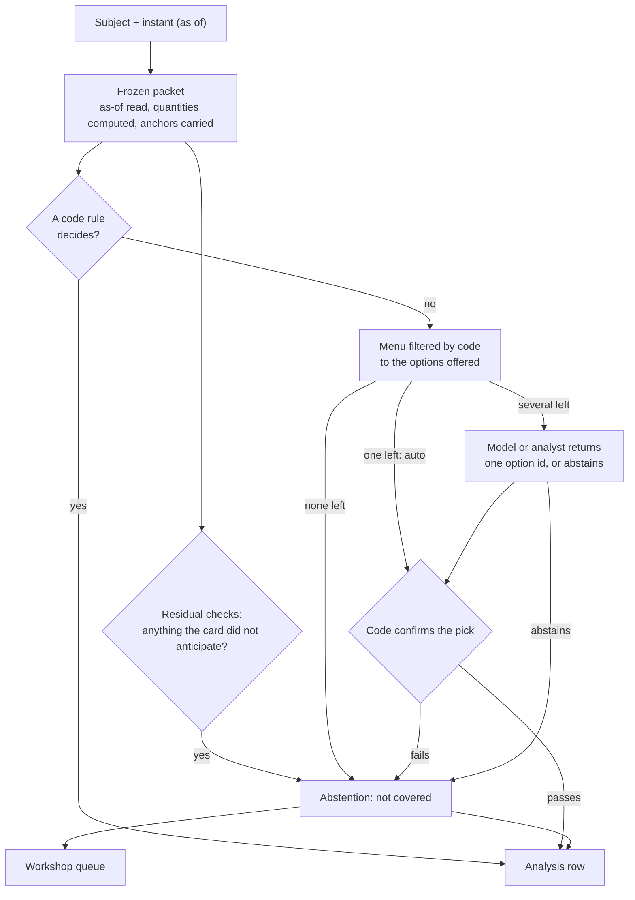

[← L3](L3-subject-cards.md) · [Up: Blueprint](README.md) · [L5 →](L5-scenarios-score.md)

# L4 — Analysis as data

## TL;DR

For a subject and an instant, the engine freezes what was knowable, computes what the card asks for, and decides in a fixed order: a code rule, else a model's pick from a filtered menu, else "not covered".
Every decision becomes a dated, typed row with its run log, so an analysis can be queried, compared and scored like a price index.
No sentence is ever written by the model: it returns an identifier, and code checks every pick.

## Purpose

Turn the reading of a situation, the most discretionary step in macro research, into **rows in a
table**: which situations hold, which lenses read them and how their baselines read them, which
scenarios open, how a central-bank statement leans, as of which instant, on which data and which
card versions.

**Success looks like:**
- Every run replays deterministically from its run log: same data, same card versions, same stored
  model responses, same rows.
- No row contains free text; every explanation is a reference to a pre-written brick.
- Every run publishes its coverage, including what no card anticipated.

## The run

### 1. The frozen packet

For a subject and an instant, code reads the fact store **only through the read**
([contract](data-contracts.md#the-read)) and computes every quantity the card declares, in the
card's order, with the closed operations.

- Each quantity is a series (period to value), so averages and gaps can read its history. Its value
  in the packet is the last computable period, stored with that period. A quantity older than the
  card allows is stale and absent.
- Each value carries the anchors of the values it was computed from.
- What cannot be computed is absent, with a type from the same list as the fact store: a month never
  collected, a hole in the periods, a pace asked of a series of the wrong frequency.
- **No forecast is read as an observation.** Every fact is typed observation or forecast in the
  catalogue, which also covers nowcasts of a period that has ended but is not yet released. A
  forecast is used only where the card reads it as a forecast, attributed to its forecaster and its
  publication date.
- A gap between two series is an as-of join on period end: for each period of one, the latest value
  of the other whose period ended at or before it.

### 2. Rules

Code evaluates the card's situations on the packet, and every lens's reading next to its baseline's.
No model is involved.

### 3. Menu choices

A menu is for a judgement that a threshold cannot make: how a central-bank statement leans, against
a fixed codebook; which of several mechanisms a card's evidence points to.

- **Offer.** Each option declares the conditions under which it is offered. Code filters the menu.
  No option left: abstention. One option left: taken without a model (`auto`), still confirmed, and
  counted with the rules.
- **Ask.** With several options left, the model, or an analyst, receives the packet's values, the options' text and,
  where the card names one, the captured document to read (a statement, the minutes). It returns a
  structured answer: one option identifier, or `ABSTAIN`; and, where the card requires it, a
  quotation given as an anchor into that document.
- **Confirm.** Each option also declares the conditions that must hold afterwards. Code re-reads the
  quotation through its anchor, checks that it lies in the section the card requires, and checks the
  pick against the numbers: a pick that says "driven by energy" must be confirmed by the computed
  contribution. A pick that fails becomes an abstention, never a published error.

The prompt, the options offered, the raw response and the sampling parameters are stored with the
row.

### The analyst's call

A human analyst can make the same judgements, on the same menus. The analyst's pick goes through the
same offer and confirm conditions, the same quotation check and the same run log, and is stored with
`decided_by = analyst`. It is scored like any other row. That is how discretionary judgement itself
becomes data: a human call, a model's pick and a rule can be compared on the same record, and an
analyst's call on a situation no card covers is exactly what the workshop turns into the next card.

### 4. Residual checks

An abstention from a menu only covers what the card listed. The residual catches what it did not:

- a quantity outside its calibrated range;
- no situation of any lens holding;
- a scheduled event with no reading: an FOMC, ECB or SNB decision, a major release;
- a flag raised by a human reader, stored in its own record against the row or subject it concerns,
  so the run it comments on is never altered.

Each produces a residual item for the workshop; the first three also produce a residual row in the
run.

### 5. Storage

Each outcome becomes a row in the append-only analysis store ([records](data-contracts.md#records)):
the decision kind (situation, lens reading, baseline reading, menu pick, scenario, analogue,
abstention, residual), how it was decided (rule, auto, model, analyst, abstained), the card entry, the claim kind and the run. The run log
holds the engine version, the card fingerprints, the theory catalogue version, the model and prompt
version, the sampling parameters, the packet fingerprint, the instant and the mode (live, replay,
counterfactual).

### 6. Coverage and the residual

Each run computes, for each decision kind, the share decided by rules, by menu choices (model or
analyst) and abstained, and the count of residual items. Coverage measures how much of a reading is
specified in advance and checked, not how good it is; that is the score's job. A card can raise its
own coverage by listing easy situations; it cannot hide its residual. Residual items are counted
apart from abstentions, never twice.

## What the model may and may not do

| It may | It may not |
|---|---|
| Return one identifier from a menu code has already filtered | Write a sentence that appears in an output |
| Point to a passage of a captured document, by anchor | State a number |
| Abstain | Settle a contradiction between lenses: both are kept |
| | Be given data later than the run's instant |

## Typed claims

A row is not free text, and its kind is declared. The contract distinguishes eleven kinds of claim:
description, measurement, association, identity, causal effect, causal mechanism, forecast,
scenario condition, valuation, legal status and normative. Most errors in macro commentary are type
errors: a correlation sold as a cause, an accounting identity sold as behaviour, a forecast sold as
a fact. The kind is set by the card entry and stored on the row; a causal kind is only allowed where
the card cites the study that identified the effect.

## Interfaces

| Direction | Artefact | From / to |
|---|---|---|
| in | The read of the fact store | [L1](L1-facts.md) |
| in | Card versions, pinned by fingerprint; theory catalogue version | [L3](L3-subject-cards.md), [L2](L2-theory-map.md) |
| out | Analysis rows with run logs | Analysis store, read by [L5](L5-scenarios-score.md) and [L6](L6-outputs.md) |
| out | Instantiated scenario sets | [L5](L5-scenarios-score.md) registry |
| out | "Not covered" items with their context | [L3](L3-subject-cards.md) workshop queue |
| out | Coverage and residual per run | [L6](L6-outputs.md) |

## Gates

**Entry.** The fact store answers reads for the subject's series, and the subject has an accepted
card.

**Exit.** Pass when:
- the packet is shown unable to see past its instant, by a test that plants a later value, and
  unable to read a forecast as an observation;
- the packet's quantities agree with an independent calculation, written without seeing the
  engine's, on several real dates;
- a planted bad pick, a planted false quotation and an empty menu each end in an abstention;
- each residual check fires on a planted case;
- a run replays deterministically from its run log, and a re-pick reports its agreement rate;
- coverage and residual are stored for every run.

## Steps

1. **Packet.** *Execution.* The read and the closed operations, with anchors and periods carried.
2. **Rule evaluation.** *Execution.* The card's condition language, lens readings and baselines.
3. **Menus.** *Design.* Offer and confirm conditions, the structured answer, the codebooks for
   central-bank statements; the prompt under version control.
4. **Checks.** *Design and execution.* Quotation by anchor and section, computed confirmation, and
   the conversion of any failure into an abstention.
5. **Residual.** *Design and execution.* The four residual checks and their workshop items.
6. **Rows and run logs.** *Execution.* The analysis store, append-only and idempotent.
7. **Coverage.** *Execution.* Per run, per subject, per decision kind.

## Deliverables

- The packet builder and its as-of guarantee.
- The decision engine: rule, menu, abstention, residual.
- The analysis store and its run logs.
- The coverage table.

## What it refuses

| It refuses | Because |
|---|---|
| Any read of the fact store without the run's instant | The analysis would see the future. |
| A projection read as an observation | A forecast is not a fact about its period. |
| A model output that is not an identifier from the menu | No free text in production. |
| A quotation whose anchor does not re-read, or lies outside the required section | It may be invented, or out of context. |
| A failed check published as a result | An abstention is a valid output; an error is not. |
