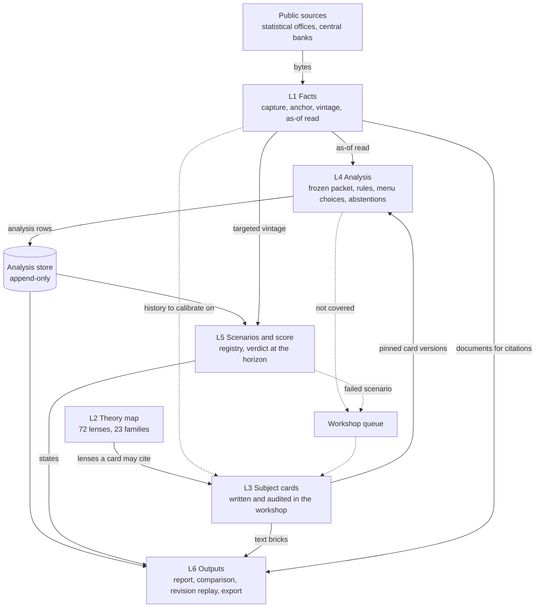

[Up: Atlas Research](../README.md)

# The blueprint

## TL;DR

Six layers turn public data and economic theory into reports that are themselves data.
Facts (L1) and knowledge (L2, L3) feed an analysis stored as dated choices (L4), whose scenarios are scored (L5) and whose outputs are assembled from stored rows only (L6).
Two loops keep it alive: a situation the cards do not cover, and a scenario that fails, both go back to the workshop that writes the cards.

## The system in one drawing

Solid arrows are data a layer reads through a written contract. Dashed arrows are the two
feedback loops: they open work in the workshop, they never change a stored row.

## One report, from source to score

Take US inflation on a given date, the subject the build starts with.

1. **Facts.** The CPI, the PCE price index and their core measures, inflation expectations and
   the policy rate are captured from their publishers as bytes, with a fingerprint and a capture
   date. Each value is anchored to the byte range it was read from. A revision adds a vintage;
   nothing is overwritten ([L1](L1-facts.md)).
2. **Packet.** For the chosen instant, the engine reads only what was knowable then and computes
   what the card asks for: year-on-year rates, three-month annualised pace, the gap to the target in
   force, the gap between headline and core. Each computed value carries the anchors of the
   values it came from ([L4](L4-analysis.md)).
3. **Rules.** The card's situations are code conditions on those values, for instance "PCE or
   core PCE more than half a point above the target". Code decides which hold
   ([L3](L3-subject-cards.md)). Residual checks flag what the card did not anticipate.
4. **Choices.** Where no rule decides, such as how the latest FOMC statement leans, code filters a
   short menu of pre-written options to those that may be offered, and a language model, or an
   analyst, returns one option's identifier, or abstains. Code then checks the pick against the numbers and the
   document.
5. **Lenses.** The card says which lenses of the theory map read this situation and which values
   each reads: a sticky-price reading, a cost-push reading, a fiscal reading
   ([L2](L2-theory-map.md)). They are kept side by side.
6. **Scenarios.** The card's conditional scenarios (if core pace stays above its trend, core
   inflation is higher at six months, unless...) are instantiated with their triggers,
   invalidations, outcome definitions and targeted releases, and registered by the run
   ([L5](L5-scenarios-score.md)).
7. **Report.** The page is assembled from stored rows and pre-written text bricks only. Every
   number on it is dated and sourced; every scenario shows what would invalidate it
   ([L6](L6-outputs.md)).
8. **Score.** When the release a branch targeted comes out, the branch is judged on that vintage,
   and compared with its lens's baseline and with published benchmarks. A miss puts the card back
   in the workshop queue.

## The stores

| Store | Kept by | What it holds |
|---|---|---|
| Capture archive | L1 | Every captured document as bytes, with its fingerprint, source and capture date. |
| Point-in-time fact store | L1 | Every value with its period, its vintage, its anchors and its four instants: released, knowable, captured, entered. |
| Theory catalogue | L2 | The 72 lenses and their declared fields, versioned. |
| Card library | L3 | Every subject card, versioned and fingerprinted, with its audit record. |
| Analysis store | L4 | Every rule outcome, menu choice, abstention and scenario as a dated row with its run log, marked live, replay or counterfactual. Append-only. |
| Scenario registry | L5 | Every registered scenario set, its judgement date and, later, its states. Append-only. |
| Workshop queue | L3 | Uncovered situations and failed scenarios waiting for a card to be written or revised. |

## Where to find

| Topic | Start here |
|---|---|
| What "point in time" means, and the kinds of absence | [L1](L1-facts.md), [data contracts](data-contracts.md#time) |
| The 72 lenses, and four worked in detail | [L2](L2-theory-map.md) |
| What a subject card contains, and how it is audited | [L3](L3-subject-cards.md) |
| The order rule, menu choice, abstention, and what the model may never do | [L4](L4-analysis.md), [principles](principles.md) |
| What makes a scenario valid, and how it is judged | [L5](L5-scenarios-score.md) |
| Comparing two reports, re-reading one against revised data | [L6](L6-outputs.md) |
| Identifiers, records, time and replay | [Data contracts](data-contracts.md) |
| Where the build starts, and what closes each phase | [Build sequence](build-sequence.md) |
| A term | [Glossary](glossary.md) |
