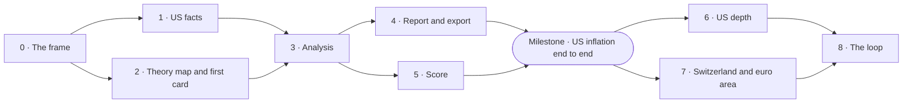

[Up: Blueprint](README.md)

# Build sequence

## TL;DR

Atlas is built along one subject first: US inflation, from the source to its first registered scenario, before any breadth.
Then depth on the United States, then Switzerland and the euro area by adding sources and cards only, then the loop that turns real gaps into cards.
Every phase ends on a gate and an isolated review by someone who built none of it.

## The phases

| Phase | What it builds | Layers | Leave when |
|---|---|---|---|
| **0 · The frame** | The rules of the build, access to the sources, the model behind the menus | All | Every source of the first economy has answered a real download; for Switzerland and the euro area, the same base series have been downloaded from their official sources, or the economy waits; one call to the model has returned a structured choice, with its latency and cost measured. |
| **1 · US facts** | The series catalogue, capture, anchoring, vintages, the as-of read, capture from the release calendar | [L1](L1-facts.md) | Every value re-reads from its bytes; the as-of read cannot see a planted later vintage; capture runs from the calendar. |
| **2 · Theory map and first card** | The lens catalogue, the thin families deepened for the US subjects, the card format, the workshop, the US inflation card | [L2](L2-theory-map.md), [L3](L3-subject-cards.md) | The inflation card passes its schema, its isolated audit and its out-of-sample test; every lens it cites is complete. |
| **3 · Analysis** | The frozen packet, rules, menu choices, checks, the analysis store, coverage | [L4](L4-analysis.md) | The packet agrees with an independent calculation on real dates; a planted bad pick becomes an abstention; a run replays identically. |
| **4 · Report and export** | The renderer, the two formats, report manifests, the point-in-time export | [L6](L6-outputs.md) | A planted sentence that is not a brick makes the render refuse; the export hides every analysis row before its production date. |
| **5 · Score** | Scenario validation, the registry, judgement on the targeted vintage, the loop to the workshop | [L5](L5-scenarios-score.md) | Each validity rule refuses a planted invalid set; a revision that should change a verdict does. |
| **Milestone** | US inflation, end to end | All | Facts, card, analysis, report, export and one registered scenario, for one live date; the first report has been read by a human before anything is published. |
| **6 · US depth** | Cards for growth, jobs, the Fed and rates, credit, the budget, the external accounts and the dollar, housing; every lens's inputs wired to series; regular reports; cards that compose others | [L1](L1-facts.md)–[L6](L6-outputs.md) | Every US subject has an accepted card; a report runs at each major release; a composed card passes its out-of-sample test. |
| **7 · Switzerland and euro area** | Their series and sources, cards adapted to them: the SNB and the franc as a safe haven with exchange-rate interventions, the ECB and the euro area | [L1](L1-facts.md), [L3](L3-subject-cards.md) | Reports run for both, and the engine was not modified to get there. If it was, the change is recorded and its cause removed. |
| **8 · The loop** | Real abstentions turned into cards, a dashboard of coverage, model cost, reports and scenarios awaiting judgement | [L3](L3-subject-cards.md)–[L5](L5-scenarios-score.md) | At least one "not covered" from production has become an audited card that a later report used; a final isolated review against the [principles](principles.md) finds nothing blocking. |

## Why this order

- **One subject end to end before breadth.** A chain that works on one subject proves every
  interface between layers; seven half-built subjects prove none. US inflation goes first because
  its data are long, public and revised, and because it is where competing lenses disagree most
  visibly.
- **Facts and knowledge in parallel.** Phases 1 and 2 share no dependency: the store and the first
  card can be built at the same time, and meet in phase 3.
- **Score before depth.** A scenario that is never judged teaches nothing. The registry runs from
  the first live report, because the record only accumulates forward
  ([principle 8](principles.md#8-analysis-is-clean-from-its-production-date)).
- **Breadth by cards, as a test.** Phase 7 is the proof of [principle 5](principles.md#5-knowledge-in-cards-not-in-code):
  if adding an economy needs a change to the engine, the design has failed somewhere, and the
  phase says where.
- **The loop last, on real gaps.** The workshop queue is only worth tuning once production has
  filled it with real abstentions.

## How a phase closes

1. Every step of the phase is done, each in its own change, with its proof.
2. The phase's exit checks pass, or each failure is explained in writing.
3. **An isolated review**: a reviewer who built nothing in the phase checks it against the
   principles. Findings are fixed or answered in writing.
4. The phase closes when the review finds nothing blocking.

## After the sequence

Other economies, then sectors, companies and assets, enter the same way: sources added to the
catalogue, cards written and audited in the workshop. The engine does not change.
